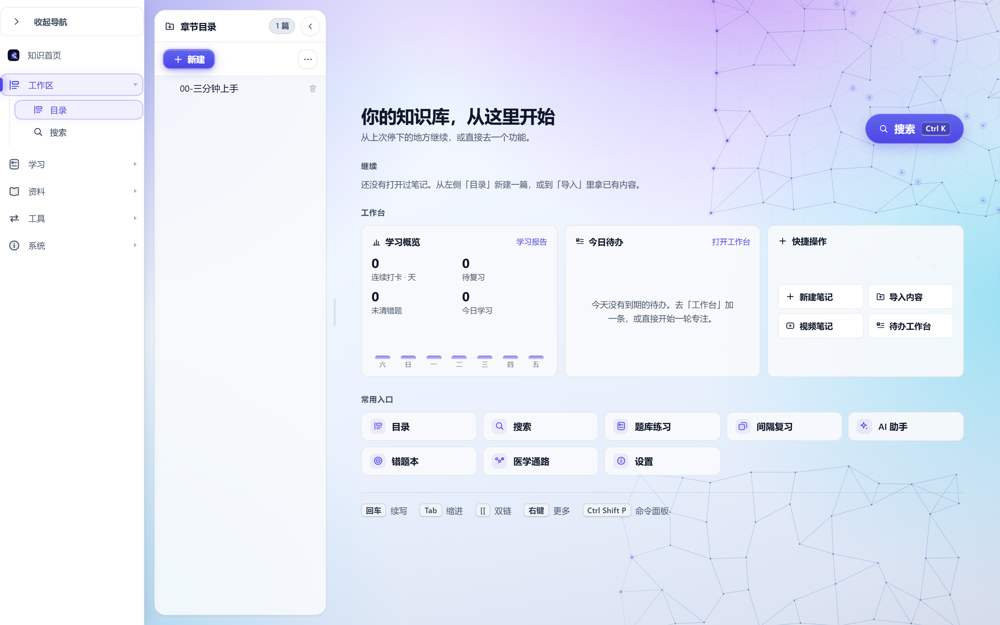
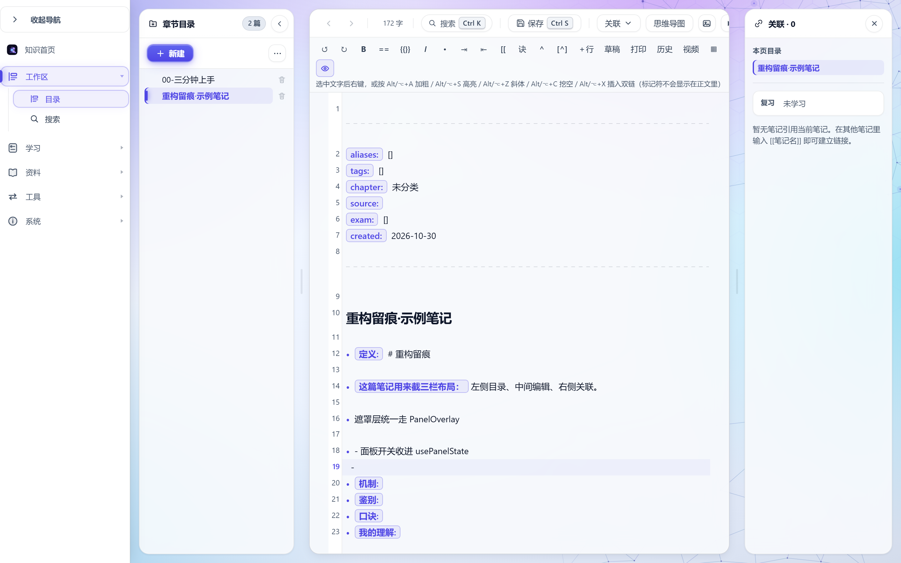
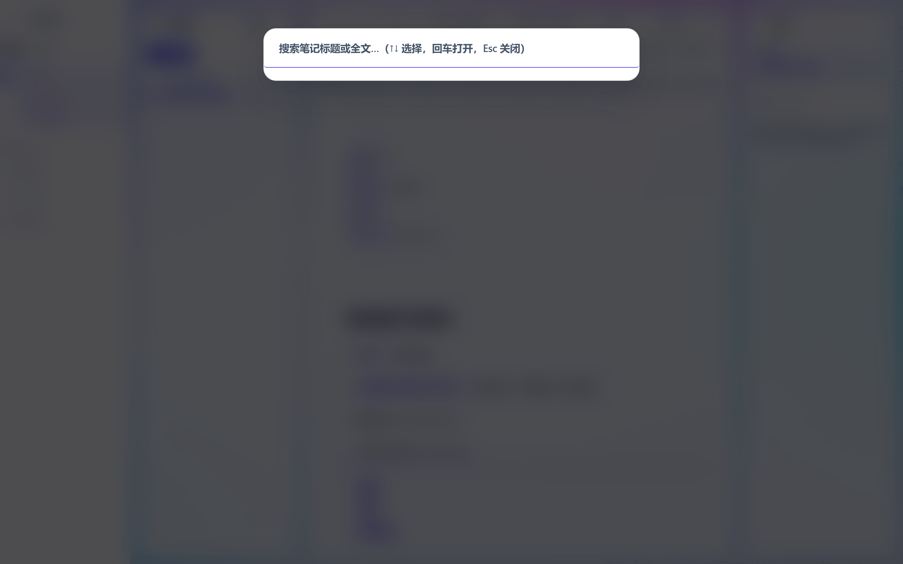
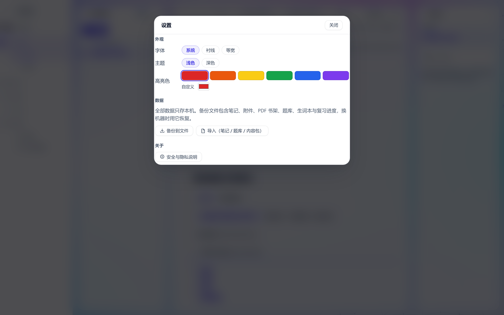
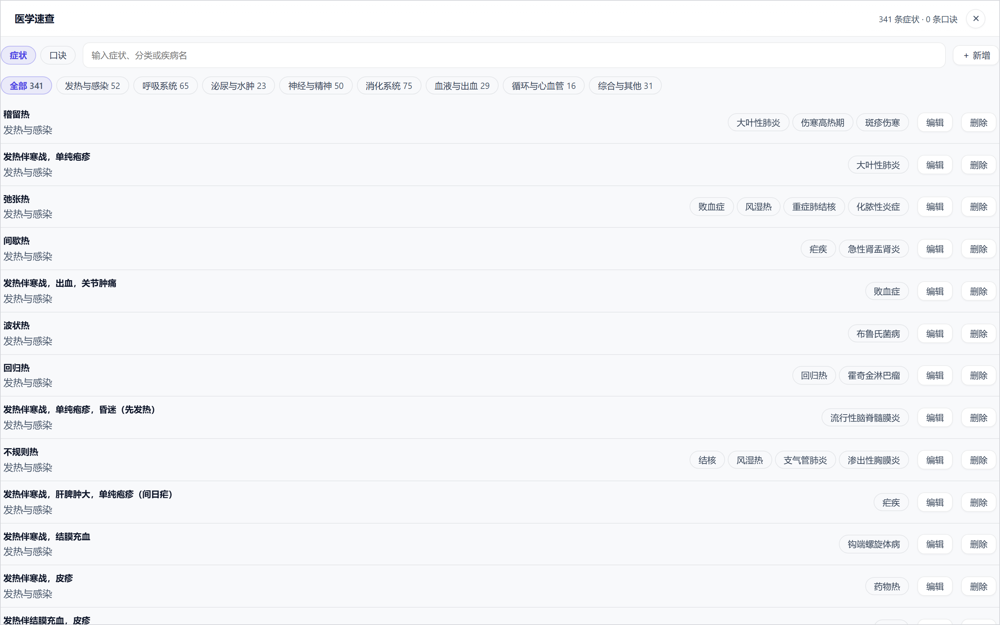
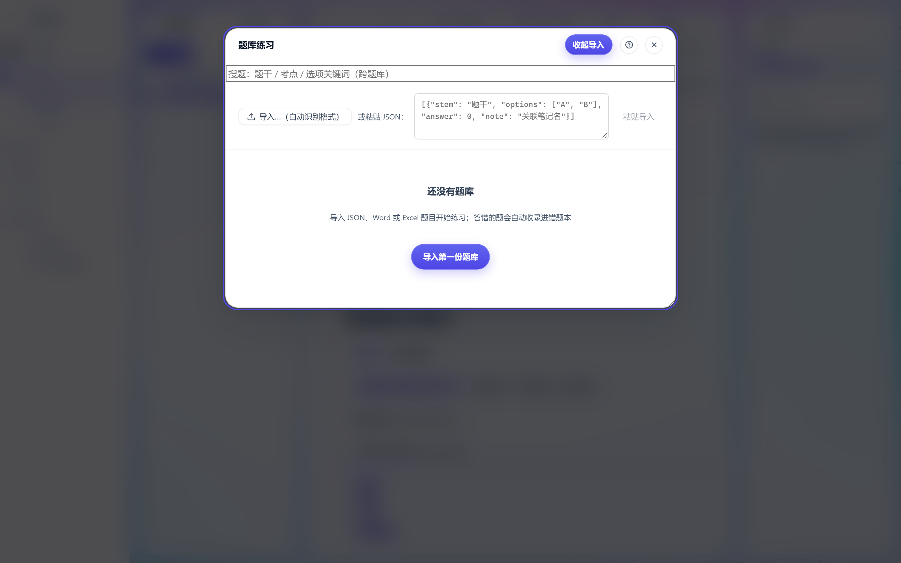
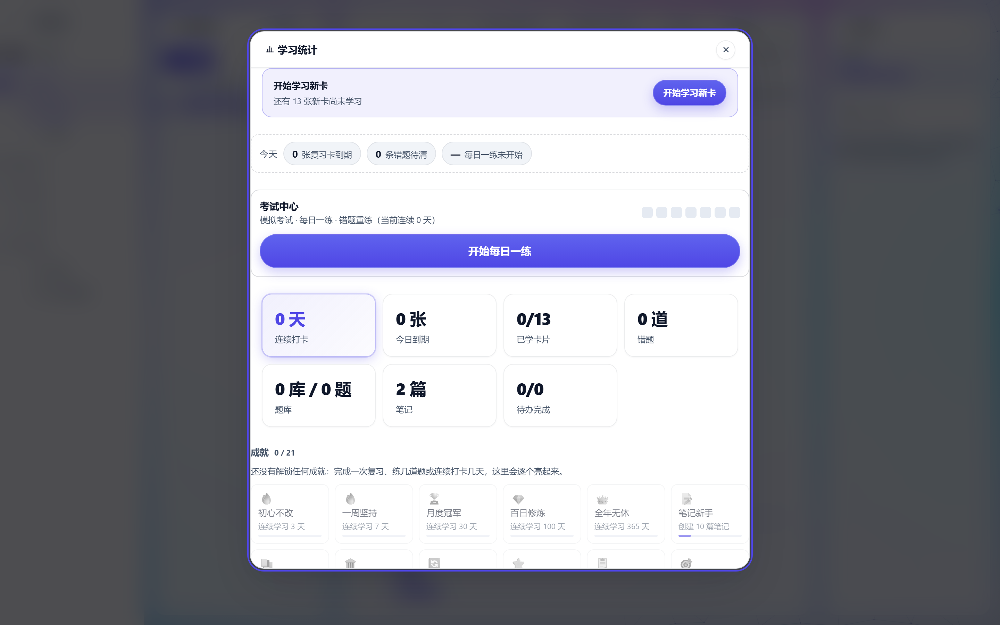

# 重构留痕 · 2026-10-30

> 范围：面板层（遮罩 / 开关 / 注册表）与持久化层。**不改行为、不调样式**——界面应当零变化，
> 本文的截图就是这一点的证据。
>
> 复现截图：`npx vite --port 5175`，另开一个终端 `node scripts/screenshots.mjs`。

## 一、改了什么

### 1. 遮罩层：28 处手写 → 1 个组件

`src/views/PanelOverlay.tsx`（新增 58 行）

改之前，18 个视图各自拼这一层，写法有三种：`panel-backdrop` + `DialogSurface`、
`panel-backdrop` + 普通 `panel`、以及整屏面板自带 `panel--full`。
「点外面才关」靠内层手写 `stopPropagation` 保证——**忘写的那几处就变成「点面板里任何地方都关闭」**。

```tsx
// 改之前（18 个文件里各写一遍，判定还不一致）
<div className="panel-backdrop quiz-overlay" onClick={requestClose}>
  <DialogSurface className="panel quiz-panel" onClick={(e) => e.stopPropagation()}>
```

```tsx
// 改之后
<PanelOverlay tone="quiz" onClose={requestClose}>
  <DialogSurface className="panel quiz-panel">
```

判定改为 `e.target === e.currentTarget`，内层写不写 `stopPropagation` 都对。
**Esc 不接管**：各面板仍走 `core/escStack` 的显式栈，否则一次 Esc 会关掉两层。

结果：`grep 'className="panel-backdrop'` 从 28 处 → **0 处**。

### 2. 面板开关：四张表 → 一张表

`src/views/panelRegistry.ts`（119 行）+ `src/views/usePanelState.ts`（56 行）

同一批面板原本被描述了四遍，加一个功能要同步改四处、漏一处就是线上 bug：

| 原位置 | 描述的是什么 |
|---|---|
| `railCatalog.tsx` | 轨上有没有入口 |
| `featureRouting.RAIL_MODAL` | 打开它要不要先关别的面板 |
| `Workspace.openFeature` | 点轨上按钮执行什么 |
| `Workspace.modalClosers` | 切换面板时怎么把它关掉 |

现在只有 `PANELS` 一张表（`id / rail / modal / group`），其余三个全部派生。

Workspace 里 **28 个 `useState(false)` → 1 个 `usePanelState()`**，`modalClosers`
那张 24 行的机械表删除，`closeModals` 直接遍历 `MODAL_IDS`。

一个必须记住的约束（已写进文件头注释与 AGENTS.md）：

- `open / close / toggle / set` 的引用**永久稳定**，可以放心进 `useCallback` / `useEffect` 依赖；
- `is` 依赖当前集合，引用随开关变化，**进依赖数组前必须先提成局部变量**
  （Workspace 里已有三处示范：`dockVisible` / `pdfPanelOpen` / `aiPanelOpen`）。

### 3. 持久化：一把散沙 → 一个入口 + 一份清单

`src/storage/kv.ts`（241 行）

`defineStore<T>` / `defineRawStore`：把「读-解析-校验-回退」「写-吞掉配额错误」收成一处。
**不改存储格式**，老数据原样可读，所以迁移是 1:1 替换，不存在「升级后用户数据读不出来」。

`KV_KEYS` 登记 71 个 localStorage 键（谁在用、存什么），`IDB_NAMES` 单独登记两个 IndexedDB 库名。
`core/theme.ts` 作为示范已迁移——注意它存的是裸值 `dark` 而不是 `"dark"`，
用 JSON store 会静默回退成浅色，这就是 `defineRawStore` 必须存在的原因。

### 4. e2e 金场景：导轨全量入口

`e2e/smoke.spec.ts` 追加一条：遍历 **17 个整屏入口**，每步验证
「打开 → 只允许一层遮罩 → Esc 关掉 → 无 JS 报错」。

数层数时只数**最外层**容器（医学速查、图片库是 `panel-backdrop > panel--full` 的嵌套形态，
直接数元素会把一个面板算成两层——这是写这条用例时真踩到的）。

## 二、界面截图

重构动的是内部结构，界面**必须一模一样**。以下 7 张是改完后逐屏实拍（1440×900，2x）。

### 首页



### 三栏编辑态（目录 | 编辑器 | 关联）



### 快速搜索 · z-index 100，压在所有面板之上



### 设置面板 · `PanelOverlay` + `DialogSurface` 组合形态



### 医学速查 · `panel-backdrop > panel--full` 嵌套形态（最容易数错层的那种）



### 题库练习 · 遮罩半透明 + 模糊，卡片居中



### 学习报告 · 另一套色调（`mistake-overlay`）



## 三、验证

```
npx tsc -b                              → 通过
npx oxlint                              → 0 errors（1 warning 在未跟踪的 researchPlot/special.ts）
npx vitest run --exclude "**/researchPlot*"
                                        → 236 passed | 4 skipped，2701 passed
npx playwright test                     → 6 passed（含新增的导轨全量用例）
```

`2701 = 基线 2678 + 新增 23`（`panelRegistry.test.ts` 11 条 + `kv.test.ts` 12 条），回归为零。

新测试钉住的不变量：

- `open / close / toggle` 的引用在多次渲染后仍然相同（Workspace 有 6 处 hook 依赖它们，
  一旦换身份就会反复解绑重挂监听、重建图谱）；
- 关一个本来没开的面板不产生新集合；
- `medvault-*` 遗留键只允许出现在 `core/migrate.ts`；
- 源码里直接写的字面量存储键必须登记在 `KV_KEYS`。

## 四、刻意留下的口子

| 项 | 为什么不做 |
|---|---|
| **CSS `@layer` 治理** | 8,075 行、`.editor-host` 出现 54 次。视觉回归无法用单测证明，必须配合截图基线逐屏比对，硬塞进这一轮只会制造「说不清是谁引起的」回归 |
| **`useVault` 切切片** | 性能改动，判据是「保存一篇笔记是否还全树重算」，需要 profiling 对照，不是测试能证明的事 |
| **89 个模块全量迁 `defineStore`** | 机械替换，但每个模块的 decode 规则不同（数组 / 对象 / 裸字符串 / 嵌套校验）。建议按 `qbank` → `srs` → `todos` 的边界分批，每批独立发布 |
| **`SafetyNotice` 自有遮罩** | 用 `.notice-overlay`，样式与 `panel-backdrop` 不同，强并会改视觉。e2e 里已单独认领它 |

另：`src/core/researchPlot/` 是工作区里未跟踪的新目录，它自己的 4 个用例失败，与本次无关。

## 五、依赖变更交代（超出「依赖不动」约束的两处，均经实测验证）

本次重构附带了两处 `package.json` 依赖变更，逐条交代理由与证据：

| 变更 | 理由 | 实测证据 |
|---|---|---|
| `pdfjs-dist` 3.11.174 → **6.4.299**；移除 `@react-pdf-viewer/*` 全家桶，新增 `NativePdfViewer.tsx` 直接用 pdfjs 官方 viewer 组件 | 旧栈是「react-pdf-viewer 包装 pdfjs 3.x」两层皮：3.x 已停更、历史 CVE 多，包装层反而挡住了官方修复。直接用官方 viewer 少一层维护面，主版本对齐后安全补丁可跟随升级 | `e2e/pdf-viewer.spec.ts`（示例渲染 / 翻页 / 文本搜索）在换栈后通过；`npm run build` 体积预算通过（PDF 按需 692 KB < 800 KB 预算） |
| `overrides: { tar: "7.5.22" }` | 消 npm audit 告警加的保险钉。**经查当前 lockfile 里已无任何 `tar` 传递依赖**，此 override 现在不生效、保留无害；若后续工具链重新带入 tar，它会自动把版本钉到无 CVE 的 7.5.22 | `node -e "...packages 里 /tar$/"` 输出 `[]`（2026-11-07 核对） |

其余差异核对：`package.json` 的变更只有 ① 上述两处依赖变更、② devDependencies 新增 `@playwright/test`（e2e 冒烟落地）、③ scripts 入口（`test:e2e` / `sizebudget` / `ui:interact` / `features:gen`，以及 `prebuild`/`build`/`lint` 接上校验脚本）；`package-lock.json` 的大 diff 是 pdfjs 主版本带动的重新解析。全部新功能（课程工坊 / 资料生成 / 单词工坊 / 背诵 / 导师模式等）**零新增运行时依赖**。
